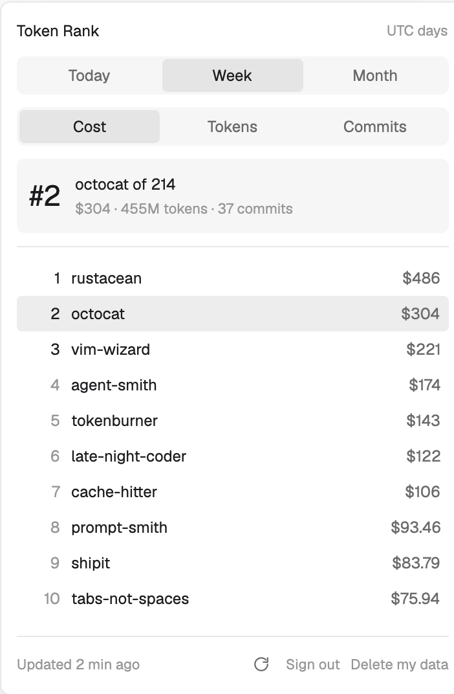

# Token Rank for Herdr

A Herdr mod that puts your AI coding spend in the status bar and ranks it against other Herdr users. It reads the session logs Claude Code and Codex already write on your machine, prices every request per model, counts the commits you made in the repositories your agents worked in, and shows daily, weekly and monthly leaderboards by cost, tokens or commits.



## Install

1. Copy `mods/token-rank` into `~/.config/herdr-app/mods/`.
2. Put it in a layout. In the default layout's status row, add a block next to the existing ones:

   ```json
   { "id": "token-rank", "type": "block", "size": { "weight": 1.2 }, "min": 150, "content": { "mod": "token-rank" } }
   ```

3. Run `herdr-app check ~/.config/herdr-app/mods/token-rank`.

The status bar shows today's tokens right away. Hover it and choose **Sign in with GitHub** to join the leaderboard.

Optional keys (`keys.json`): `"token-rank:refresh"`, `"token-rank:sign-in"`, `"token-rank:sign-out"`. The same commands run from a shell with `herdr-app do token-rank.refresh`.

Requirements: macOS or Linux, `git`, and `sh`/`awk`. [ripgrep](https://github.com/BurntSushi/ripgrep) is used when it is installed and makes the first scan of a large history much faster.

## What is sent

Nothing leaves your machine until you sign in. After that, every 10 minutes the mod uploads, per UTC day:

- model ids with token counts (input, cache reads, cache writes, output), grouped by prompt size so long-context prices apply;
- the first 16 hex characters of each commit id you authored in the last 40 days (the server stores only a keyed hash of them, so a commit seen on two machines counts once);
- a random id for the machine, so two machines add up instead of overwriting each other.

Prompts, code, file names, repository names and paths are never sent. The leaderboard shows your GitHub login. GitHub sign-in asks for no permissions (public profile only), and the server never stores the GitHub token. **Delete my data** in the panel removes your account and everything uploaded for it.

## How it counts

- **Claude Code**: `~/.claude/projects/**/*.jsonl` (or `$CLAUDE_CONFIG_DIR`). One request per message id and request id; a streamed request written twice counts once.
- **Codex**: `~/.codex/sessions` and `archived_sessions` (or `$CODEX_HOME`). One request per `token_count` event. Resumed sessions and subagents replay their parent's events in a new file; those replays are recognised by session, model, request usage and running total, and count once.
- **Cost** is computed on the server from [pricing.json](worker/src/pricing.json), taken from [ai-token-monitor](https://github.com/soulduse/ai-token-monitor). Rates are list API prices per model, including cache and long-context tiers. Subscription plans are not reflected.
- **Commits** are non-merge commits on any branch whose author email matches `git config user.email` of that repository.
- Days are UTC days so everyone shares the same boundaries.

The scanner (`mods/token-rank/helpers`) records each request once in a local ledger under `~/.local/state/herdr-token-rank` and only re-reads log files that grew. A first scan of a large history runs in several 7-minute steps; later scans take seconds.

## Server

`worker/` is a Cloudflare Worker with a D1 database, deployed at `https://herdr-rank-api.kohanacloud.com`.

| Endpoint | Purpose |
|---|---|
| `GET /v1/leaderboard?period=day\|week\|month&metric=cost\|tokens\|commits[&date=YYYY-MM-DD]` | Top 100, cached at the edge for 60 s |
| `GET /v1/me?period=&metric=` | Your totals and rank |
| `POST /v1/usage` | Upload day totals |
| `POST /v1/auth/device`, `POST /v1/auth/token` | GitHub device flow |
| `POST /v1/auth/logout`, `DELETE /v1/me` | End the session, delete the account |

Every upload replaces that machine's day totals and recomputes the user's day, week and month totals in one transaction, so a leaderboard read touches only the rows it returns. Uploads are validated (40-day window, integer counts, size limits) and rate limited per user; sign-in and reads are rate limited per IP.

### Operate

```sh
cd worker
npm install
npm test && npm run typecheck
npm run migrate:remote     # after adding a migration
npm run deploy
```

- Secret: `COMMIT_MARK_KEY` (`openssl rand -hex 32 | npx wrangler secret put COMMIT_MARK_KEY`). Optional `GITHUB_CLIENT_SECRET` lets the server revoke each GitHub token right after sign-in.
- Prices: replace `worker/src/pricing.json` with a newer copy from ai-token-monitor, run the tests, deploy. New uploads use the new prices; days already stored keep their cost until the machine uploads them again.
- Hide an account from the leaderboard: `npx wrangler d1 execute herdr-token-rank --remote --command "UPDATE users SET hidden = 1 WHERE login = 'name'"`.
- A daily cron removes expired sessions and data older than 400 days.

## License

MIT. See [LICENSE](LICENSE) and [NOTICE](NOTICE).
