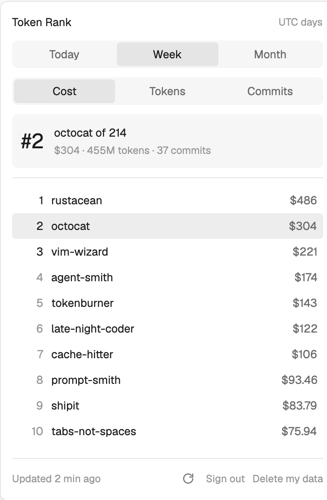

# Token Rank

A status-bar block that shows how much AI coding you did today and where that puts you among other Herdr users. Hovering it opens a leaderboard of cost, tokens or commits for today, this week or this month, with your own rank on top and GitHub sign-in to join.

## What you see

- **Status-bar block** (one row of the layout's status row, 28px high): `theme().chrome` background with a 1px `border` top line, 12px side padding, content right-aligned. A 13px trophy icon (`icons/trophy.svg`, tinted) and one 11.8px label:
  - before sign-in: `77M tokens today` (muted), or `Reading logs…` during the first scan;
  - while signing in: `Enter 7ABE-0D06 on GitHub` (foreground);
  - signed in: `#3 today · $38.18` (foreground), or `$38.18 today` when the rank is not known yet.
- **Hover panel** (HoverCard anchored bottom-right, 250ms open, 300ms close), 360px wide, 12px padding, 10px gaps, 8px radius, `popover` background, `border` 1px, large shadow, 12px text:
  1. Title row: `Token Rank` semibold, `UTC days` 11px dim on the right.
  2. Two segmented controls on a `raised` track with 2px padding: Today / Week / Month, then Cost / Tokens / Commits. The chosen segment has the `selected` background and `foreground` text, others `muted`.
  3. Optional notice line, 11px, `ansi3`.
  4. Account block:
     - signed out: a muted sentence, an 11px dim privacy line ("Shares daily totals only: model names, token counts, an estimated cost and commit count. Never prompts, code, file or repository names."), and a `solid` **Sign in with GitHub** button;
     - signing in: "Enter this code on GitHub. It is on your clipboard.", the code at 20px semibold, an **Open GitHub** button and **Cancel**;
     - signed in: a `raised` card with the rank at 22px semibold (`#1`, or `—`), `login of N` and an 11px dim line `$1913 · 5.8B tokens · 243 commits` for the chosen period.
  5. A 1px rule, then the top 100 in a 280px scroll area: rank (28px, right-aligned, `foreground` for the top 3, else `dim`), GitHub login (truncated), value on the right (`$420`, `5.8B`, `17`). Your own row has the `selected` background. Empty: "No one on this board yet."
  6. A 1px rule and a footer: 11px dim status (`Updated 3 min ago`, `Reading session logs…`, or `Scan failed: …` in `ansi1`), a 22px refresh icon button, and when signed in **Sign out** and **Delete my data** (11px dim text; the second turns `ansi1` and reads "Click again to delete" until clicked again).

## How it behaves

- On start and every 10 minutes it runs `helpers/scan.sh` with `exec` (10-minute timeout). The script reads Claude Code and Codex session logs, keeps a ledger of requests in `~/.local/state/herdr-token-rank`, and prints day totals and commit ids. Signed in, it then uploads changed days and refreshes the standings.
- Hovering the block refreshes the shown leaderboard and the user's standing if they are older than a minute. Picking a period or metric does the same for the new view.
- **Sign in with GitHub** asks the server for a device code, copies it to the clipboard, opens github.com/login/device, and polls until GitHub approves. On success a toast says "Signed in as …" and the first upload starts.
- An expired session (401) signs out and shows "Your session ended. Sign in again to keep ranking."
- Commands: `refresh`, `sign-in`, `sign-out` (keys: `"token-rank:refresh"`; shell: `herdr-app do token-rank.refresh`).
- Nothing animates; the label changes only when data changes.

## Built from

- One mod, `mods/token-rank`, placed by the layout as a block in the status row (`mod.json`: `"place": "none"`).
- `herdr`: `exec` (`sh scan.sh`), `readTextFile`/`writeTextFile` (`auth.json`, `uploaded.json` in the state folder), `spaces()` (local space folders are added to the repositories it reads commits from), `notify`, `nextCommand`, `theme`, `checking`.
- `gpui-base`: `HoverCard`, `h_flex`, `v_flex`. `cx.open_url`, `cx.write_to_clipboard`, `cx.sleep`.
- `fetch` to `https://herdr-rank-api.kohanacloud.com` (Cloudflare Worker + D1, source in `worker/`).
- Programs: `sh`, `awk`, `find`, `wc`, `sort`, `split`, `git`; `rg` when installed, else `grep`.

## Watch out

- The mod reads files outside its folder (`~/.claude`, `~/.codex`, git repositories), runs programs, and reaches the network after sign-in.
- `readTextFile` only reads up to 1 MiB and mod JS cannot read part of a file, so log parsing lives in the shell script; JS only sees aggregated lines.
- BSD grep is slow on large Codex logs. The script searches 300 files per call, records progress after each batch, and stops reading after 7 minutes; the next run continues. A history of tens of GB can take a few runs the first time.
- Codex replays a parent session's `token_count` events into a new file on resume and for subagents. Count a request once by (session id, model, last_token_usage, total_token_usage).
- Claude Code writes one request on several lines; keep the largest usage per message id + request id.
- Days are UTC. Upload only days the server accepts (the last 40); keep one day of margin.
- `herdr-app check` runs `init`: skip scanning and network when `checking()`.
- macOS and Linux only (the scanner is POSIX sh).

## Done when

- `herdr-app check mods/token-rank` passes.
- Within a minute of loading, the block shows today's token count without signing in.
- `sh mods/token-rank/helpers/scan.sh /tmp/state` prints `U`, `C`, `D` and a final `S … complete` line; running it again right away reports few changed files and finishes in seconds.
- Sign in completes from the panel, the block switches to `#N today · $X`, and the panel lists the leaderboard with your row highlighted.
- **Delete my data** (two clicks) signs out, and `/v1/me` with the old token answers 401.
